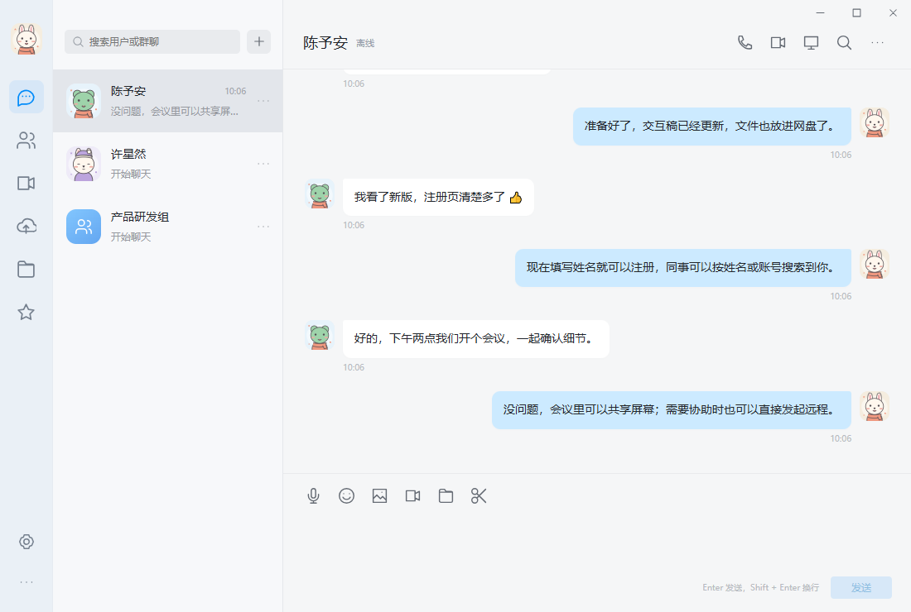
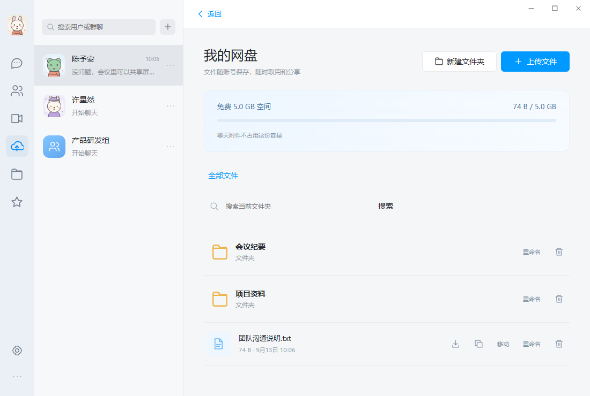
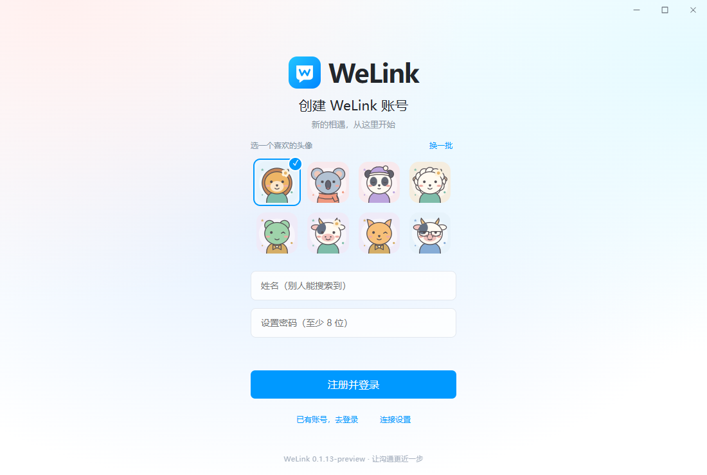
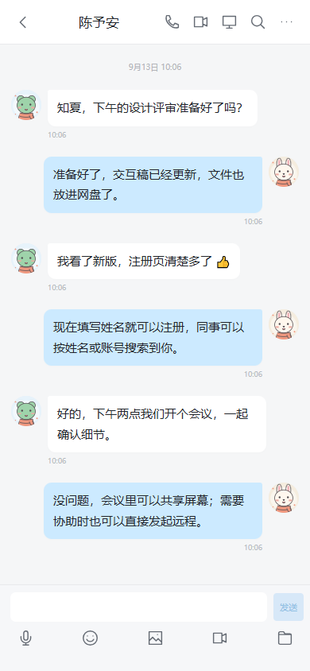

# WeLink · 即时通讯

面向企业员工的即时通讯应用，支持 Windows 和 Android。使用 Go 构建服务端与共享客户端内核，提供单聊、群聊、文件传输、音视频通话、多人会议、远程协助和个人网盘。可自行部署，管理员可创建账号和维护员工资料，自助注册通过配置文件开启或关闭。

Windows 使用原生 WebView2，Android 使用原生宿主。界面交互参考 QQ，远程协助与会议技术参考 YuDesk；使用独立品牌和账号系统。目前为 **0.1.13-preview** 预览版本，完整实现范围和待完善项目见 [功能对照](docs/FEATURE_PARITY.md)。

## 下载

| 平台 | 下载 | 要求 |
| --- | --- | --- |
| Windows | [安装版](http://www.yucg.cn:8251/downloads/WeLink-Setup.exe) · [便携版](http://www.yucg.cn:8251/downloads/WeLink-Windows.exe) | Windows x64，Microsoft Edge WebView2 Runtime |
| Android | [APK](http://www.yucg.cn:8251/downloads/WeLink-Android.apk) | Android 8.0+，支持 ARM / x86 四种架构 |

[下载页](http://www.yucg.cn:8251/) · [SHA-256 校验值](http://www.yucg.cn:8251/downloads/SHA256SUMS.txt) · [本次更新](docs/REGISTRATION_RELEASE_20260913.md)

## 主要功能

- **即时消息**：单聊与群聊，文字、表情、图片、语音、视频和文件；引用、撤回、转发、收藏及历史搜索。
- **员工协作**：6 位数字账号，按姓名或账号搜索，直接开始聊天；员工资料、用户管理、密码重置与设备管理。
- **音视频与会议**：语音 / 视频通话、多人会议、屏幕共享、会议邀请和链接；优先 P2P，连接失败时使用中转。
- **远程协助**：从单聊发起，受邀方同意后连接，支持远程画面全屏。
- **个人网盘**：默认每人免费 **5 GB**，支持文件夹、上传、下载、移动、重命名、删除与永久分享；聊天附件不计入网盘额度。
- **桌面与移动端**：浅色 / 深色主题、桌面托盘、提示音开关、截图、离线消息缓存，以及手机扫码登录电脑。

## 界面截图

以下截图使用本地演示账号和示例内容。

**Windows 即时聊天**



**个人网盘：文件夹与 5 GB 额度**



**账号注册**



**移动端聊天布局**（以 Android 界面尺寸展示）



## 使用

最新客户端：[0.1.13 · 注册页面整理、姓名与 5 GB 网盘](docs/REGISTRATION_RELEASE_20260913.md)。此前更新：[0.1.12 · 截图绘制、图片对齐与加载优化](docs/LOADING_SCREENSHOTS_20260912.md)。[0.1.11 · 员工资料管理与远程全屏](docs/EMPLOYEE_PROFILES_REMOTE_20260912.md)。[0.1.10 · 管理员注册、统一搜索与群聊恢复](docs/GROUP_WORKFLOWS_20260912.md)。[0.1.9 · 会议全屏、共享与设置返回修复](docs/MEETING_CONTROLS_20260912.md)。[0.1.8 · 返回、会话移除与触摸操作修整](docs/USABILITY_20260911.md)。[0.1.7 · 桌面快捷键、开机启动与截图标注](docs/DESKTOP_EXTRAS_20260911.md) 的功能继续保留。[0.1.6 · 离线聊天记录与重连核对](docs/RECEIVED_CACHE_20260911.md) 和 Android [0.1.5 · 麦克风采集与会议资源释放](docs/ANDROID_CAPTURE_20260911.md) 的功能继续保留。

双端客户端功能：[0.1.4 · 特别关心、分组和跨设备同步](docs/SPECIAL_CARE_20260911.md)。

客户端修复记录：[0.1.3 · 同时重连的音视频协商修复](docs/MEDIA_NEGOTIATION_20260911.md)。[0.1.2 · 系统安全边距、麦克风波动、Windows 黑屏与托盘图标](docs/CLIENT_STABILITY_20260911.md) 的修复继续保留。

- 下载页：<http://www.yucg.cn:8251/>
- 默认服务：`http://www.yucg.cn:8250`
- Windows：运行 `WeLink-Setup.exe` 安装，或直接运行 `WeLink-Windows.exe`。需要 Microsoft Edge WebView2 Runtime。
- 设置中的“消息提示音”可独立开启 / 关闭，保留通知与未读，各设备分别保存。Windows 默认关闭后留在系统托盘继续接收消息；双击托盘图标或再次打开 WeLink 恢复窗口，右键托盘可完全退出。“设置 → Windows 桌面设置”可修改关闭行为和后台新消息提醒。免打扰群保留 @提醒，隐藏中的当前聊天不会自动标为已读。
- Windows 桌面设置可选登录系统后启动、最小化到托盘和全局快捷键；默认 Ctrl+Alt+W 显示主窗口，Ctrl+Alt+A 截图，冲突时可修改。原生框选后支持画笔、矩形、箭头、文字、马赛克、撤销，确认后复制、保存或发送到指定聊天。桌面偏好写入客户端资料目录的 `desktop.json`。
- Android：安装 `WeLink-Android.apk`，支持 Android 8.0+；包含 arm64、ARMv7、x86_64、x86。当前为直接安装的预览 APK。
- 自助注册由服务器配置 `registration.enabled` 控制，当前部署已开放。登录页可填写姓名、密码并选择头像，系统分配永久 6 位 WeLink 号码。管理员也可从“设置 → 管理员 · 账号管理”注册员工账号，姓名必填，初始密码可留空自动生成。管理员可编辑员工姓名、手机号、性别、职位及个性签名，可重置任何账号的密码，并删除普通账号。仅用 6 位数字账号登录，不接受姓名或旧别名。
- 注册和“编辑资料 → 更换头像”提供 100 个内置卡通头像，每次推荐 8 个，可换一批或查看全部；也可上传照片、拖动裁剪、缩放、旋转或恢复默认。照片最大 8 MB、单边最多 4096 像素，保存为 512 像素静态头像。群主和管理员可在群设置修改群头像，个人与群头像同步到其他在线设备。
- 桌面登录页点击“使用二维码登录”；安卓登录后从消息页“+ → 扫一扫”或“我的 → 扫一扫 · 电脑登录”扫描。手机核对数字后确认，电脑自动登录。二维码 3 分钟有效、单次使用；也支持选择二维码图片。
- 会话列表点击每行“更多”、Windows 右键或 Android 长按，可置顶、免打扰、标为已读、从消息列表移除。移除直接执行、不弹确认，只隐藏本账号会话，保留聊天历史和群成员资格。设置子页左上角提供返回，安卓系统返回键按当前页面逐层返回。
- 消息右键（Windows）或长按（Android）可引用、复制文字、收藏、删除，自己发送的消息可在两分钟内撤回。删除同步到本账号的所有设备，不影响对方记录或独立保存的收藏；撤回会同步清除引用中的原文。
- 右键 / 长按消息可转发，或进入多选后逐条转发、合并转发、批量删除。可同时选择好友和群，附带留言；合并记录支持查看详情、图片、文件和嵌套记录。转发保留独立副本，原聊天后续删除 / 撤回不会修改已转发的内容。
- 语音消息：点击输入栏麦克风；Windows 点击开始录音与发送，安卓按住说话、松开发送、上滑取消，最长 60 秒。点语音气泡播放 / 暂停。视频可从输入栏发送，安卓另有系统相机拍摄入口；支持 MP4 / WebM、缩略画面与播放器，聊天附件默认不设应用大小上限。音视频也支持转发、收藏、搜索、撤回；发送失败可在当前窗口重试。
- 聊天右上角搜索或“聊天设置 → 查找聊天记录”支持内容 / 文件名、类型、发送人、日期筛选，加载更早记录和查看上下文。点击消息下方的引用也可定位原消息。
- 断网重启后可查看和搜索本机已加载的聊天记录；联网后核对撤回、个人删除和群访问权限。默认保存合计 5000 条、20 MiB、100 个会话、30 天，可由服务器配置。“设置 → 本机聊天缓存”可清理，保留服务器记录、草稿和待发送消息；附件内容仍需联网。
- 群聊输入 `@` 或点击输入栏 `@成员` 选择要提醒的人；群主和管理员可 `@全体成员`，消息右键 / 长按可 `@TA`。未读提醒显示在群列表，免打扰群仍保留 @提醒；进入会话可定位提醒消息，历史搜索支持“只看 @我的消息”。普通输入的 `@姓名` 与转发的旧消息不会自动产生提醒。每条文字最多 50 处提醒。
- 顶部搜索同时查找用户和群聊；“+”保留建群及 Android 扫码，移除重复的人群搜索入口。Windows 右击用户、Android 长按用户可直接创建群聊，默认以自己和对方的名字命名，之后可改名、继续邀请多人。
- 群设置可查看永久数字群号、群成员与名片、群公告，管理搜索入群方式、成员邀请、管理员、禁言和群主转让，并提供退出 / 解散入口。成员邀请直接入群，仍遵守邀请开关、屏蔽与人数限制。新群默认允许直接加入、关闭公开搜索；已有群的公开搜索和入群设置保留。已加入的群始终可在统一搜索和“联系人 → 群聊”中找到，移除消息列表后点击即可恢复聊天与历史，无需再申请。公开搜索仍由群主控制；最多 200 人、10 位管理员。
- 全部用户都可通过姓名、号码或用户 ID 搜索，直接发消息、语音通话或视频通话，无需好友申请。聊天自动进入最近联系人，最新消息会话排在前面（置顶优先）。“从列表移除”只隐藏会话，保留历史、备注和分组；下次收发消息重新显示。联系人资料可屏蔽或取消屏蔽对方私聊消息，保留历史和本人主动发送能力，共同群聊不受影响；黑名单另行限制私聊。
- 左侧导航分别使用消息、联系人、会议、云朵网盘、聊天文件夹、收藏和个人图标，互不重复。
- 网盘免费 5 GB / 账号，支持文件夹新建 / 重命名 / 删除、逐层返回、文件移动、拖入或选择文件、目录内搜索、下载、重命名、删除和永久分享链接。聊天附件不占网盘容量；大文件直接上传，需保持客户端运行。支持通过配置添加扩容盘，原盘离线时新文件写入可用磁盘，旧文件在原盘恢复后可读。
- 联系人显示自己在线；点击聊天头像可查看账号、手机号、性别、职位，用户可在编辑资料中填写或清空。聊天文件列表可下载或删除，删除个人文件消息会同步到自己的设备，保留对方记录和独立收藏。
- 写文档模块已按使用反馈从客户端移除；网盘文件管理继续保留。
- “设置 → 账号与安全”可修改密码、查看登录设备并退出指定设备 / 其他设备。退出立即断开对应聊天、会议与远程协助；修改密码会保留当前设备、退出其他设备，并使未完成的扫码授权失效。
- 远程协助只在用户单聊顶部保留一个入口，群聊和左侧不显示；在用户单聊中发起远程协助，对方同意后开始。远程画面顶部可全屏 / 退出，Windows 支持 Esc 退出及最小化后恢复，结束后恢复普通窗口；Android 全屏隐藏系统栏，返回或进入后台时恢复。Android 共享屏幕需系统 MediaProjection 授权；远程触控另需主动开启无障碍权限。
- 用户搜索结果、个人资料与单聊右上角可拨打语音 / 视频电话，对方接听后连接；支持视频来电语音接听、取消 / 拒绝 / 忙线 / 超时、通话计时和记录。详情见 [通话说明](docs/CALLS.md)。
- 从“会议”或群聊右上角发起音视频会议，输入 9 位会议号加入，也可以邀请当前好友 / 群。参考 YuDesk 的会议目前最多 8 人、最长 2 小时；主持人可共享屏幕、转交主持、录制和结束会议。两端会议均采用白色面板、浅灰背景和蓝色控件。安卓录制当前只保存屏幕画面，不含声音。
- 会议内可邀请好友并复制“会议链接 + 会议号”。Windows 邀请统一显示在桌面右下角的独立白色弹框，带系统提示音和进入按钮，主窗口隐藏时仍可接收；不显示 App 页面内邀请卡片。安装版可通过邀请链接唤起加入确认，详见 [会议邀请说明](docs/MEETING_INVITATIONS.md)。

语音、视频和会议优先尝试 P2P 直连，默认 8 秒仍未连通时加入 TURN UDP / TCP 中转并重新协商；界面显示实际连接路径。HTTP 由本次部署要求指定：登录与聊天传输不使用 TLS。远控数据通道使用 YuDesk 加密协议；通话和会议媒体在直连与中转时均使用 WebRTC DTLS/SRTP，信令经 HTTP/WebSocket。详见 [媒体连接与稳定性](docs/MEDIA_RELAY_AND_STABILITY.md)。

## 构建

环境：Go 1.27.1、Node.js / npm；Android 需要 JDK 21、Gradle 8.11.1、Android SDK 35、NDK 27.3.13750724 和 Python 3。

```powershell
npm ci
npm run build:ui
# 在 Windows Go 环境中
go build -trimpath -ldflags="-s -w -H=windowsgui" -o dist/WeLink-Windows.exe ./cmd/welink
# 安装器内嵌已经构建的客户端
New-Item -ItemType Directory -Force cmd/welink-setup/payload
Copy-Item dist/WeLink-Windows.exe cmd/welink-setup/payload/WeLink-Windows.exe
Copy-Item internal/ui/assets/icon.svg cmd/welink-setup/payload/icon.svg
go build -trimpath -ldflags="-s -w -H=windowsgui" -o dist/WeLink-Setup.exe ./cmd/welink-setup
```

Linux / Docker 中构建服务端：`CGO_ENABLED=0 GOOS=darwin GOARCH=arm64 go build -trimpath -ldflags='-s -w' -o dist/welink-server-darwin-arm64 ./cmd/welink-server`。Android 在隔离副本中执行 `bash scripts/build-android.sh`，脚本会安装固定版本 gomobile 并修改构建副本的 Go 工具依赖；离线构建时需预先缓存 Gradle 依赖 / WebRTC AAR。

UI 源文件在 `internal/ui/src/`，构建到 `internal/ui/assets/`。Windows 由 Go 内嵌；Android 的 Gradle 任务会将同一份界面资源打包进 APK，并在启动时更新到应用私有目录。编辑源文件后先执行 `npm run build:ui`，再构建客户端；仅调整安卓界面时可直接运行 Gradle，不必重建 Go 绑定。无需另行部署前端服务器。

## 服务管理

远端目录 `~/bin/welink`，配置在 `welink.json`，SQLite 保存在 `data/welink.db`，日志在 `logs`。1 TB 外盘目标目录为 `/Volumes/My1TB/yuconggen/welink`，目前 macOS 尚未授权后台服务访问，配置 `storage.primary_enabled: false`；已启用 `/Users/yu/bin/welink/storage-expansion` 作为扩容卷，分别使用 `uploads`、`yunpan`、`spaces` 子目录，预留 8 GiB 系统磁盘空间。使用 macOS 登录域 LaunchAgent `cn.welink.server` 保持服务运行。它会在该用户登录后启动，不代表登录前的系统守护服务。

自助注册的开放和关闭均修改 `~/bin/welink/welink.json` 中的以下字段，保留文件其余配置：

```json
"registration": {
  "enabled": true
}
```

`true` 开放，`false` 关闭；更改后重启服务生效，无需重新编译或安装客户端。当前 LaunchAgent 配置了 KeepAlive，可执行 `launchctl kill SIGTERM gui/$(id -u)/cn.welink.server` 让服务正常退出并自动启动。`GET /api/public-config` 返回实际的 `registrationEnabled` 状态；客户端启动时读取，已打开的登录页需完全退出客户端后重新打开以更新入口。此开关仅控制自助注册，关闭时管理员仍可创建账号。

每个账号的网盘额度使用同一配置文件中的 `drive.quota_gb`，默认及当前部署均为 `5`。配置单位按 1024³ 字节计算；修改后重启服务生效。降低额度不会删除已有文件，超出额度时暂停新增网盘上传，仍可下载或删除已有文件；聊天附件不占此额度。完整配置示例见 [welink.example.json](config/welink.example.json)。

```sh
launchctl print gui/$(id -u)/cn.welink.server
launchctl kickstart -k gui/$(id -u)/cn.welink.server
curl http://127.0.0.1:8250/health
~/bin/frp/upnpc-refresh.sh 8250 8251
```

8250、8251 已加入现有 UPnP 刷新脚本默认端口列表。音视频使用 TCP / UDP 8252 与 UDP 20000–20127，已通过 `scripts/upnpc-media-refresh.py` 建立永久映射，保留其他服务映射。后台刷新任务当前访问网关失败，SSH 手动执行成功；路由器清空映射后需手动刷新，详情见媒体说明。更新二进制时保留 `data`，先备份数据库与文件；Mac 上先签名、验证版本文件，再切换 LaunchAgent，避免覆盖正在使用的签名可执行文件。

## 验证

```sh
go test -timeout 900s ./internal/server
go test -race -timeout 300s ./internal/client ./internal/remote ./mobile/core
go test -race -timeout 300s ./internal/server -run 'TestRegistrationClosedAdminResetAndSelfChange|TestAdminDeletionRevokesAccessButPreservesChat|TestConcurrentDriveUploadsCannotExceedQuota|TestMessageBlocking|TestExpansionDisk|TestSixDigit'
go test ./internal/yudesk/secureconn ./internal/yudesk/protocol ./internal/yudesk/peerpath ./internal/yudesk/desktop ./internal/yudesk/stream
node scripts/windows-smoke.mjs
node scripts/storage-ui-test.mjs
node scripts/ui-test.mjs
node scripts/meeting-test.mjs
node scripts/calls-test.mjs
node scripts/media-path-test.mjs
node scripts/microphone-meter-test.mjs
sh scripts/android-assets-test.sh dist/WeLink-Android.apk
node scripts/qr-login-test.mjs
node scripts/message-operations-test.mjs
node scripts/forwarding-test.mjs
node scripts/media-test.mjs --long-recording
node scripts/groups-test.mjs
node scripts/group-workflow-test.mjs
node scripts/admin-profile-test.mjs
node scripts/remote-fullscreen-test.mjs
node scripts/contacts-test.mjs
node scripts/mentions-test.mjs
node scripts/avatars-test.mjs
node scripts/cartoon-avatars-test.mjs
node scripts/meeting-invitations-test.mjs
node scripts/desktop-ui-test.mjs
node scripts/desktop-extras-test.mjs
node scripts/usability-test.mjs
node scripts/meeting-controls-test.mjs
node scripts/outbox-test.mjs
node scripts/received-cache-test.mjs
node scripts/received-cache-policy-test.mjs
sh scripts/android-microphone-test.sh
```

存储、会议和媒体路径联调脚本需要 `.local/storage-admin.json` 中的本地测试管理员，关闭自助注册时由管理员创建测试账号；旧脚本需启用本地测试注册或通过测试管理员预置账号。媒体路径测试需本地启用 TURN 及测试用回环地址许可。Android 资源测试需要 JDK 17+，直接用 APK 验证 100 个头像的递归安装、覆盖更新、失败清理和重试。Windows 原生窗口测试每项单独启动测试进程，WebView2 DLL 在进程退出前保持映射。

界面联调脚本使用本地测试 API `127.0.0.1:18246` 和 `.local/dev-client/client.url`，当前测试客户端使用 18749，避开用户客户端 18746，不应直接改为生产地址运行。会议脚本使用 Chrome 合成麦克风 / 摄像头验证三人传输、静音和主持人控制；这不等同于手机真机或公网弱网验证。

Windows 用户数据默认在 `%APPDATA%/WeLink`；安装路径默认 `%LOCALAPPDATA%/Programs/WeLink`。SSH 私钥、APK 签名密钥、数据库、构建产物不纳入版本控制。

## 来源

YuDesk 参考仓库 `E:/yudesk`，核验提交 `8fb981decf57e4a5d26fc2dc13d96d476d9bfd6f`；会议文件还包含该工作区的最新修改。移植目录为 `internal/yudesk`，安卓会议类和会议信令 / UI 按 WeLink 身份系统适配。第三方许可保存在 `third_party/`。WeLink 使用独立品牌和账号，不接入 QQ 账号或消息系统。
