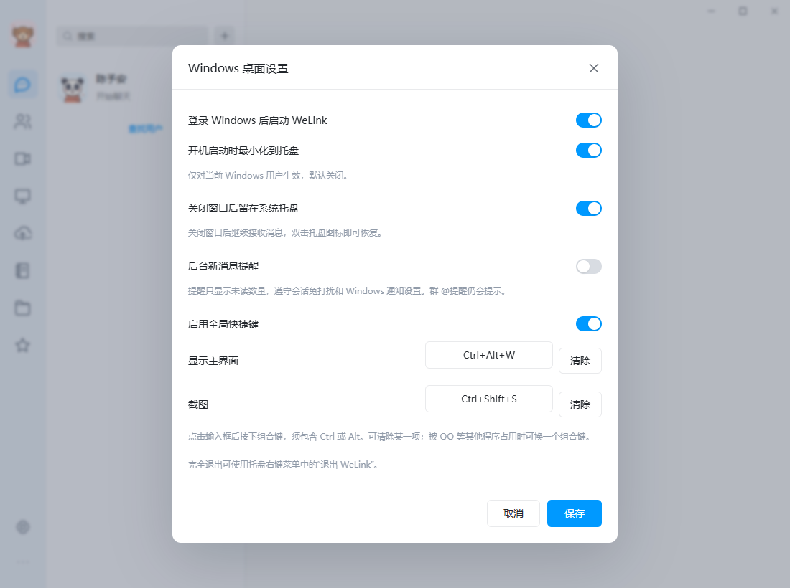
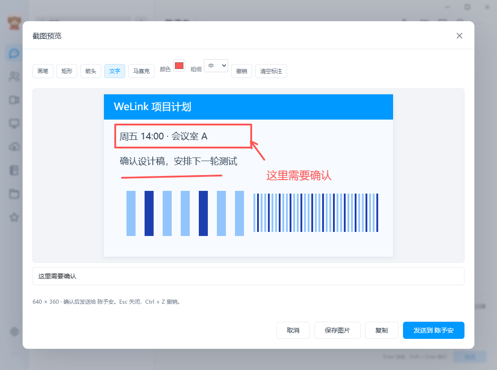

# 0.1.7-preview · 桌面快捷键、开机启动与截图

Windows 增加全局快捷键、当前用户登录后启动选项，以及原生框选截图。两端继续保留启动、托盘、系统安全边距、麦克风波动和离线聊天的既有修复。Android 本次同步共享界面，版本码为 8。

## 使用与配置

“设置 → Windows 桌面设置”可启用、停用或修改快捷键。默认 `Ctrl+Alt+W` 显示主窗口，`Ctrl+Alt+A` 截图；也可清空某一项。组合键需要包含 Ctrl 或 Alt，可加 Shift，支持字母、数字及 F1–F24（F12 除外）。其他程序占用时显示具体错误，修改失败会保留原有快捷键；启动时某一项不可用，不影响聊天或保存其他桌面设置。

“登录 Windows 后启动 WeLink”默认关闭。开启后可选择最小化到托盘；托盘不可用时使用任务栏最小化。普通手动启动仍显示主窗口。启动项仅写入当前 Windows 用户的 Run 配置；设置保存失败会回退启动项和新快捷键。卸载只清理指向本安装程序的 WeLink 启动项。

桌面偏好保存在当前客户端资料目录的 `desktop.json`，示例见 [desktop.example.json](../config/desktop.example.json)。原有仅包含关闭行为和消息提醒的配置可继续使用，新字段采用默认值。快捷键手动修改文件后重启生效；启动项需在界面保存时注册或移除，单独编辑 `autoStart` 不会修改系统注册表。

Windows 对已占用快捷键的处理见 [RegisterHotKey 官方说明](https://learn.microsoft.com/en-us/windows/win32/api/winuser/nf-winuser-registerhotkey)。登录启动由 Windows 调度，可能延迟；不改变任务管理器对启动项的停用状态，也不保证在登录前启动。参见 [Run / RunOnce 官方说明](https://learn.microsoft.com/en-us/windows/win32/setupapi/run-and-runonce-registry-keys)。

## 截图

点击聊天截图按钮或按截图快捷键，主窗口暂时隐藏，拖动框选桌面区域，按 Enter、双击或点“完成”进入浅色预览。Esc、右键或“取消”退出选区；取消时恢复原先窗口显隐状态。预览支持画笔、矩形、箭头、文字、马赛克、颜色、粗细、撤销和清空标注。图片可复制或保存为 PNG。

在聊天中发起时，预览明确显示接收对象，点击发送才会进入该聊天的既有上传队列；截图本身不会自动发送。未登录或未选择聊天时，提供复制和保存。退出登录、关闭预览或取消采集后，迟到的采集结果被丢弃并释放资源；旧的浏览器采集任务不会停止下一次采集的媒体流。

原生截图使用当前已解锁的普通桌面，保留多显示器的负坐标，裁剪后才回传预览。每次最多 32 Mi 像素，编码后的 PNG 最多 24 MiB；限制用于控制截图内存，与聊天附件和网盘容量无关。显示器布局或 DPI 改变时取消当前选区。尚未实现窗口吸附、选区拖拽缩放、长截图、OCR 或 QQ 全部截图工具；混合 DPI、多显示器实机仍待验收。Android 不提供 Windows 原生截图窗口，当前使用系统截图后选择图片发送。

## 验证

- Windows 原生测试通过：全局快捷键注册和冲突回退、当前用户启动项保存 / 回退与路径引号、截图裁剪颜色与方向、选区拖动 / 取消 / 完成、最小化启动、预览回传和资源释放。
- 剪贴板测试在独立窗口站和桌面中验证真实 CF_DIB 数据，未读取或修改用户剪贴板。截图流程使用合成桌面画面，未采集用户屏幕。
- 最终 Windows 安装包启动探测通过：WebView2 控制器可见、登录界面渲染、服务连接和注册关闭状态正常。真实原生聊天收发、托盘隐藏 / 恢复、重复启动、重启后的草稿与待发送队列测试通过。
- 浏览器测试通过：设置保存、快捷键冲突、截图不自动发送、五种标注及撤销、复制、PNG 下载、指定接收对象发送、关闭 / 重开、退出后丢弃迟到结果，以及旧浏览器采集失败不影响新媒体流。既有桌面设置、未读及提醒回归通过。
- 客户端和桌面配置 Go race 检查通过。卸载 PowerShell 脚本通过语法解析；未在用户安装目录执行卸载，也未通过注销 Windows 测试实际登录自启动。
- Android lint、构建、v2 签名、16 KB 对齐通过；120 个 UI 资源、100 个嵌套头像、4 个原生 ABI、资源升级 / 中断重试检查，以及 PCM 和麦克风生命周期 JVM 测试通过。沿用原签名证书，可覆盖安装。当前没有 Android 真机可用于录音、系统栏和跨端媒体实测。

本次尝试读取已安装 QQ 的设置参考，但原生截图工具报 `SetIsBorderRequired` 接口不支持，菜单点击也未获得可用坐标；未取得该页面的截图对照，因此不声称逐像素一致。完整未完成项继续记录在 [功能对照](FEATURE_PARITY.md)。

## 发布

本次只更新客户端安装包，服务端继续使用 `~/bin/welink/welink-server-release-20260911-04`。客户端发布前核对旧版本与完整哈希，保留旧安装包和清单至 `data/releases/before-desktop-extras-0.1.7/`；新包分阶段上传并校验后切换，失败可恢复旧文件。不改动生产账号、消息、数据库、服务配置或存储卷。

三份客户端已发布到 [下载页](http://www.yucg.cn:8251/)。远端完整 SHA-256 校验通过；公开下载的清单、字节数与首尾各 64 KiB 内容一致。HTTP 健康检查、受保护接口未登录拒绝和会议加入页面检查通过。

| 文件 | 字节数 | SHA-256 |
|---|---:|---|
| WeLink-Windows.exe | 14,346,240 | `4cd97f4fcf0ee5287196b0449f6fa1e64602df9fedcdff9c93311b4c7eae9044` |
| WeLink-Setup.exe | 17,892,352 | `b0e3267a1424405ee5908f70d39297d7033956dda054bf6f0d6a5bbb5d90551c` |
| WeLink-Android.apk | 48,399,131 | `d26fc520bbd8163bffa1f54f9d78f077f666489bdac24ed051347e8fdd7045d9` |
