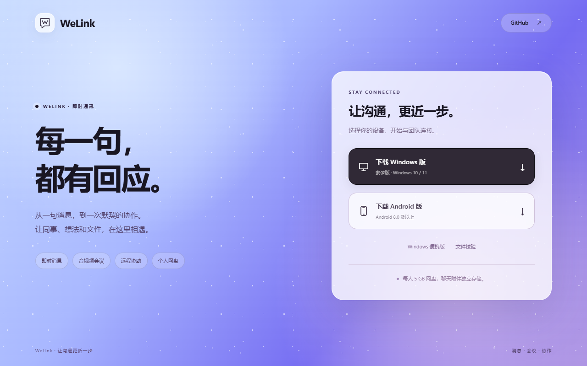

# 0.1.14 · 浅色界面与服务器飘雪页面

Windows 和 Android 客户端版本为 `0.1.14-preview`，Android versionCode 为 `15`。浅色界面参考指定的 sub2api 页面，采用蓝紫渐变、柔和的浅紫底色、圆角卡片和黑色主按钮。深色主题保持原来的颜色、布局和控件样式。

## 界面变化

- 登录、姓名注册和二维码登录共用渐变背景与飘雪；宽屏显示左侧介绍，小屏集中显示表单。注册页面继续隐藏滚动条，并保留滚轮、触摸和键盘滚动。
- 聊天列表、消息气泡、输入区、联系人、网盘、会议和设置统一浅色风格。设置中的开关保留原有功能，扩大点击范围并对齐文字。
- 服务端下载页、会议邀请页、网盘分享页以及保留兼容访问的空间链接统一使用相同背景、卡片和飘雪。客户端不恢复已移除的写文档模块。
- 会议页可复制链接与会议号，HTTP 页面通过兼容方式复制，并显示结果。文件分享继续支持永久有效期，下载和访问权限沿用原有逻辑。

## 动画与加载

飘雪由 CSS 渐变和位移动画实现，无图片、第三方字体、Canvas 或逐帧 JavaScript。窗口失焦、进入后台或页面隐藏时暂停；系统开启“减少动态效果”时显示静态雪点。移动端减少一层雪花。雪花不拦截点击，聊天工作区不播放飘雪。

## 维护位置

| 内容 | 源文件 |
| --- | --- |
| 客户端浅色样式 | `internal/ui/src/light.css` |
| 登录介绍和客户端版本 | `internal/ui/src/branding.js` |
| 双端与网页共用飘雪 | `internal/appearance/atmosphere.css`、`atmosphere.js` |
| 公共网页模板、样式和交互 | `internal/publicweb/pages.html`、`pages.css`、`pages.js` |

修改客户端后先执行 `npm run build:ui`，再构建 Windows / Android。服务端模板和飘雪资源通过 Go embed 打包，修改后需重建服务端。账号注册仍由 `welink.json` 的 `registration.enabled` 控制；网盘额度仍由 `drive.quota_gb` 控制，当前分别为 `true` 和 `5`。

## 已完成验证

- 桌面及移动尺寸的登录、注册、消息、联系人、网盘、会议和设置页面截图检查；深色主题可见控件的尺寸、颜色、边框、阴影与修改前快照一致。
- 设置返回、会话移除后历史保留、长按菜单、表情关闭、网盘文件夹操作及文件分享回归通过。
- 二维码显示、手机确认、取消、独立登录会话及重复使用拒绝检查通过。
- 下载、会议和文件分享页在桌面与移动尺寸下无横向溢出；飘雪运动、暂停、减少动态效果、点击穿透、HTTP 复制与 CSP 检查通过。
- 公共模板转义、CSP 脚本哈希、会议链接、网盘、空间访问及配置相关 Go 测试通过。
- Windows 客户端和安装器构建成功；新 Windows 包验证姓名注册、隐藏滚动条及小窗口 / 键盘弹出后的按钮可达性。
- Android 构建、lint、APK 签名、16 KB 对齐、100 个头像、资源覆盖更新和失败恢复检查通过。移动截图来自浏览器的移动尺寸测试，不代替 Android 真机验收。

## 发布

服务端发布文件为 `welink-server-release-20260914-01`，部署目录 `~/bin/welink`。切换前备份数据库、启动配置及原发布信息，切换后验证数据库完整性、关键表数量和配置保持不变。下载页为 [www.yucg.cn:8251](http://www.yucg.cn:8251/)，安装包校验值见 [SHA256SUMS.txt](http://www.yucg.cn:8251/downloads/SHA256SUMS.txt)。
