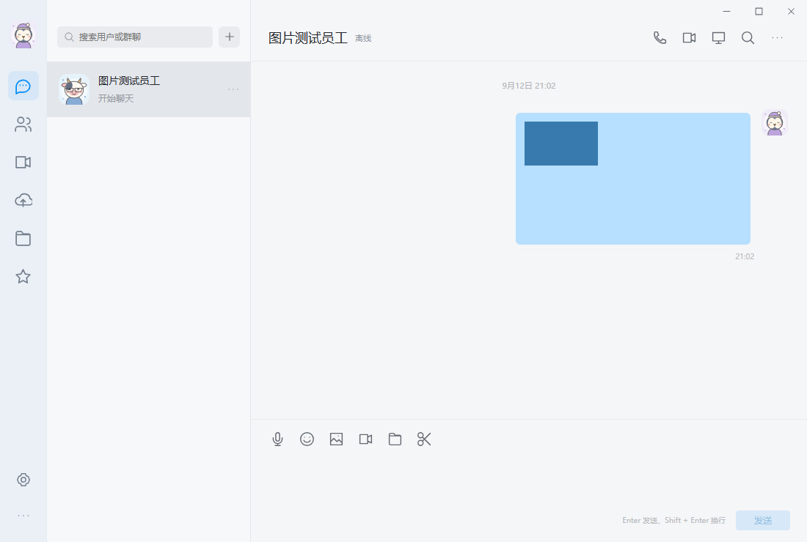

# 0.1.12-preview · 截图绘制、图片对齐与加载优化

## 修改

- 自己发送的图片靠近右侧头像，图片外框限制在 330 CSS 像素内。桌面横图原先与头像相距 215 像素，现为 15 像素；手机为 13 像素。横图、竖图和接收方消息均检查不溢出。
- Windows 截图采集在读取 DIB 内存前调用 GdiFlush，避免读取尚未完成的 GDI 写入。框选窗口只上传一次冻结画面，选区、遮罩和工具按钮先在缓冲区合成，再整帧显示；关闭时释放两个画布及其位图。
- 该同步要求见 [Microsoft CreateDIBSection 文档](https://learn.microsoft.com/en-us/windows/win32/api/wingdi/nf-wingdi-createdibsection)。用户报告的“整屏框选时蓝条”未在受控测试中稳定复现，因此不能将上述绘制修复视为对所有显卡、显示器组合的验证。
- Windows 和 Android 的 Go 本地代理复用 HTTP 连接，不再为每个接口、头像或附件创建并销毁连接池。服务地址或证书指纹修改后更换连接池，退出时关闭空闲连接；凭据仍逐请求传递。
- 公共注册配置改为后台获取，配置延迟或失败不阻塞登录，返回结果不清空已输入账号和密码。自助注册继续关闭。
- 账号核验后的服务配置和会话资料并行加载。首次连接仅补刷会话；离线恢复及后续重连仍刷新完整目录。普通消息和已读事件仅刷新会话列表，批处理期间若出现目录变更则保留完整刷新。
- Windows WebView2 初始化中断、空回调和 32 位 HRESULT 失败时返回初始化失败，避免空指针崩溃及直接终止进程。

## 验证

- `scripts/loading-layout-test.mjs` 在同一环境为每个 API 请求增加 150 毫秒延迟，用 DOM 观察器记录主界面出现时间。以前一版本 `1c603f1` 的 JS/CSS 为基线，三次重新打开均值从 **919 ms 降到 543 ms**，约减少 41%。这是受控测试，不代表所有设备及公网条件。首次加载目录的五个接口由各两次减为各一次；会话仍补刷以覆盖连接建立间隙。
- `scripts/startup-resilience-test.mjs`：公共配置挂起时可输入登录；完成后不清空输入；公共配置 503 时已登录用户正常进入；自助注册无入口；发送消息不重复请求人员和群目录。
- Go 客户端竞态检查：12 次串行请求只建立 1 条上游连接，各请求身份独立；修改服务地址、正确及错误证书指纹均校验连接池切换。
- Windows 原生测试分别在独立进程执行：真实桌面采集比对自己绘制的 385×257 测试窗，连续三组颜色；框选前遮罩及框选后原图像素；取消恢复；截图桥接；PNG 裁剪；私有窗口站剪贴板。未保存其他桌面窗口内容。
- 原生聊天、重复启动、窗口全屏和恢复集成检查通过。WebView2 失败回调覆盖空对象及失败 HRESULT；初始化被中断时不再空指针崩溃。多个原生 WebView 生命周期放在同一测试进程时可能残留退出消息，因此各原生场景独立运行。
- 截图编辑 UI 检查：标注、马赛克、撤销、复制、下载、发送、关闭及迟到回调处理。旧测试同步到“保存桌面设置后返回设置”的既定流程。
- 离线聊天缓存及容量/权限检查、草稿和发件箱恢复回归通过。
- Android 重编 Go 核心四种 ABI，版本号 13 / 0.1.12-preview；Lint、APK v2 签名、16 KB 对齐、121 个资源、100 个头像、资源升级和麦克风生命周期检查通过。未连接 Android 真机。

## 发布

仅更新下载客户端，服务端继续使用 `welink-server-release-20260912-02`。账号、消息和文件数据不迁移；保留上一版安装包到服务器 `data/releases/before-loading-0.1.12`。

下载文件在服务器完成全量 SHA-256 检查，并通过域名核对长度及首尾 64 KB。8250 健康检查正常，自助注册保持关闭。本机 Windows 安装已更新为 0.1.12，安装文件哈希一致，程序重新启动。

| 文件 | SHA-256 |
| --- | --- |
| WeLink-Windows.exe | `45175e4d07edb6d3c7b0be29b582961ec6bdbf949c4353b23157371b7611fffb` |
| WeLink-Setup.exe | `fe1f94eb8d6cdcf66f1ded19c375afd28013548d6d39d6b25103a77acfb34903` |
| WeLink-Android.apk | `f7f62deab21cfa598b0206dabbf4c2ad0838f7f34236b09cf5fcfe25db6cfefe` |
