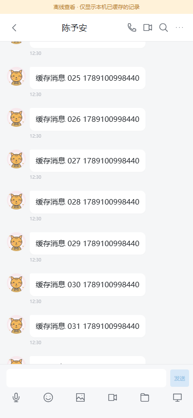
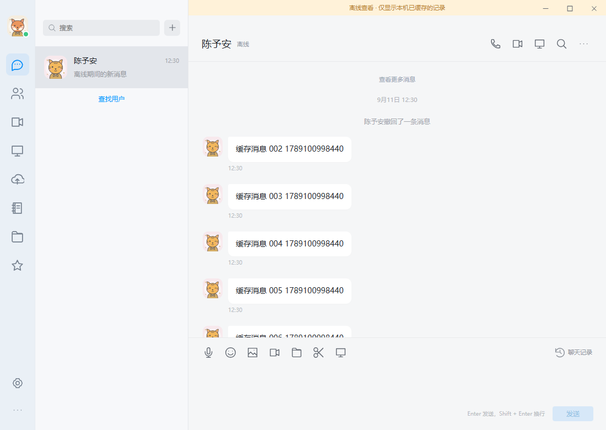

# 0.1.6-preview · 离线聊天记录

Windows 和 Android 使用同一份聊天缓存实现。断网后，包括关闭客户端再启动，可以查看此设备已加载的会话、消息和引用，并搜索、翻页。离线状态有明确提示；搜索只覆盖本机缓存。待发送消息继续使用独立的持久队列。

## 保存与同步

缓存放在应用私有 WebView 的 IndexedDB 中，按服务器地址、指纹和登录会话隔离。消息和用于恢复界面的资料采用 AES-GCM 保存，使用随机 IV 和记录身份作为附加验证数据；解密密钥由已有登录令牌导入，不在缓存记录中再次保存令牌。这不替代设备登录保护，也不改变当前 HTTP 的传输方式。

重新连接后，客户端通过新增的 `POST /api/conversations/{id}/messages/sync` 分批核对已缓存的消息。服务端检查当前登录身份、会话成员资格和个人删除状态；每批最多 200 个 ID，不修改消息。已撤回内容及引用原文会被清除，个人删除的消息会从本机移除，失去成员资格的群记录不再保留在缓存中。更新版本不需要数据库迁移。

HTTP 返回旧快照时，不会覆盖较新的撤回和删除事件。缓存上限只控制本机保存量，不截断正在浏览的在线历史页。发送成功的消息即使未收到 WebSocket 回声，也会加入缓存。

“设置 → 本机聊天缓存 → 管理”显示条数与大小，可以清理缓存。清理不删除服务器记录、登录状态、草稿和待发送消息。退出登录会清除此登录会话的已收消息缓存，并通知同一 WebView 存储中的其他窗口退出。收到服务器的会话失效响应也会清理；完全离线期间无法提前获知服务器刚刚撤销的权限。

## 可配置项

在服务端 `welink.json` 的 `chat` 对象中配置；省略时采用下面的默认值：

```json
{
  "received_cache_messages": 5000,
  "received_cache_bytes": 20971520,
  "received_cache_days": 30,
  "received_cache_conversations": 100
}
```

条数为每个登录会话的所有会话合计；容量按加密前 JSON 数据大小计，不包含 IndexedDB 自身和密文封装开销。保留时间从最近保存或核对该记录起计算，按会话消息批次淘汰。把条数或容量设为 `0` 可停用；客户端下次取得配置时清理缓存。服务器配置生效后，已离线的设备仍使用最后一次获取的配置，直到重新联网。

## 验证范围

- 服务端完整测试通过（84.804 秒），新增缓存接口的权限、删除、撤回、引用、参数边界和配置测试通过 race 检查。
- 浏览器测试覆盖 Windows / Android 布局的断网冷启动、搜索和分页、待发送队列、撤回和删除核对、退群清理、服务器与账号隔离、迟到快照、退出及失效令牌清理。
- 缓存策略测试覆盖 12 条上限、在线历史页重连时保留未缓存行、无 WebSocket 的发送回执、清理时保留发送队列、其他窗口退出、损坏与过期记录，以及服务端停用。
- 文字、文件、图片、语音和视频的持久发送队列回归通过。视频测试改用多帧 VP8 画面，避免单色画面在资源紧张时生成无法解码的测试文件。
- 网盘、空间、账号管理及浏览器 P2P / TURN UDP / TURN TCP 媒体回归通过；客户端 race 检查通过。
- Windows 原生测试通过：聊天收发、真实托盘隐藏与唤回、重复启动、重启后草稿和发送队列恢复。首次启动探测曾未在 25 秒内收到登录页回执，原因未复现；后续相同安装包检查在约 3 秒内通过，确认 WebView2 可见、登录页正常。没有把这次超时认定为已找到并修复的产品原因。
- Android lint、构建、v2 签名与 16 KB 对齐通过，构建耗时 1 分 55 秒。APK 的 119 个 UI 资源、4 个原生 ABI、100 个嵌套头像及资源安装重试检查通过；真实 PCM 计算和麦克风生命周期的纯 JVM 测试通过。版本码为 7，签名证书与之前版本一致，可覆盖安装。

本次缓存不保存图片、语音、视频和文件的二进制内容；离线时显示消息资料，附件内容及合并转发详情仍需联网。首次登录或未缓存的聊天也需要联网。当前未连接 Android 真机，浏览器视口测试不能替代不同手机的 WebView、存储压力、系统栏和录音硬件验收。





## 发布文件

| 文件 | 字节数 | SHA-256 |
|---|---:|---|
| WeLink-Windows.exe | 14,123,520 | `9cac4401a59f369d08bd4da0bf979d7736c27ecb4bd7397eefcc0f6430f8a84c` |
| WeLink-Setup.exe | 17,669,120 | `ae1014136ec537258cd74b5b8a1a5599b8789a475fe034cc47366dd6cf52cd08` |
| WeLink-Android.apk | 48,392,409 | `2c3c92b925f3c9c0c4538b07adaf5dd65d823fa1a3d2f661704b77114a0c7f56` |

Mac mini 服务端版本文件为 `~/bin/welink/welink-server-release-20260911-04`。签名前 SHA-256 为 `e7db17d662537f2de58ce9c184221776f56a6f18ca6703f4e678e1eee9815955`，Mac 上签名后的 SHA-256 为 `d12c2c21a81ae1cafbcb79808d4c7d3179c4a2efb7cea6bbc2f47712af6bc5a7`。

升级前备份数据库至 `data/welink-before-received-cache-20260911-04.db`，保存旧服务清单与 LaunchAgent 文件。配置文件逐字节保留，自助注册继续关闭，外盘仍保持停用并使用既有系统扩容卷。新缓存选项当前使用默认值，可以按上文写入配置后重启服务调整。

三份客户端均已发布到 [下载页](http://www.yucg.cn:8251/)。上一组安装包及校验清单保存在 `data/releases/before-received-cache-0.1.6/`。启用前核对远端完整 SHA-256；启用后核对公开校验清单、文件大小与首尾各 64 KiB 内容。域名健康检查、缓存接口及其他受保护接口的未登录拒绝、会议加入链接检查通过。没有在生产创建测试账号、消息或会议。
