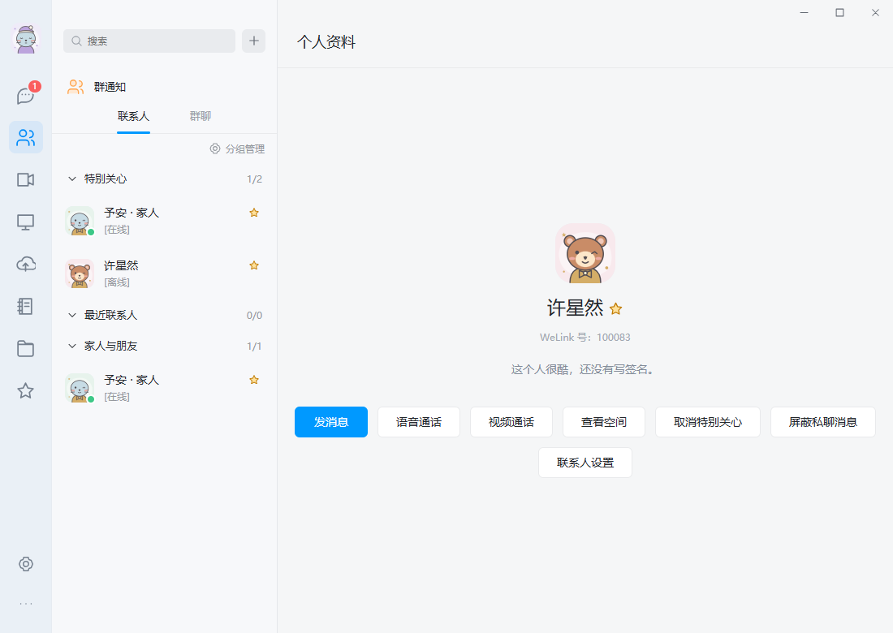
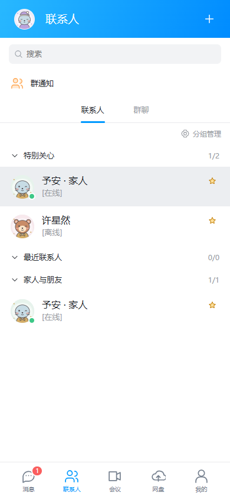

# 客户端 0.1.4-preview · 特别关心

对照本机 QQ `9.9.15.28131` 的可访问性结构，确认联系人列表有“特别关心”分组。QQ 截图接口重试后仍报 `SetIsBorderRequired failed: 不支持此接口 (0x80004002)`，菜单点击也返回 `coordinate input geometry is unavailable`，重新读取结构确认未打开菜单。因此本轮补齐联系人功能，不能作为 QQ 尺寸、颜色或完整交互逐项一致的证明。

## 使用

- 在联系人资料、联系人设置或右键菜单中设置 / 取消特别关心；手机尺寸界面支持长按菜单。
- 特别关心在联系人列表单独分组，联系人、资料和私聊会话显示星标。可以折叠分组，折叠状态只保存在当前设备。
- 名单和备注一样仅本人可见，会同步到自己的其他设备。可以标记尚未开始聊天的用户，不创建聊天记录，也不通知对方。
- 特别关心不改变会话的最近消息排序、置顶、免打扰或消息屏蔽规则。
- 从联系人列表移除时，会同时取消特别关心；确认框说明这一行为。聊天记录、备注、描述和原分组保留，下次聊天仍能查看历史。其他用户自己设置的特别关心不受影响。

## 实现与验证

服务端使用独立 `contact_attention` 表，按当前登录用户和联系人共同标识。表通过好友偏好关系的外键级联清理；生产的全员目录模式依然无需添加好友批准。修改联系人 API 的 `specialCare` 是可选字段，旧客户端修改备注时会保留特别关心。读取目录、联系人详情和单聊会话时只返回当前用户的标记。

迁移只新增表，旧备注、描述和用户资料不重建。移除联系人的操作将取消关心和隐藏最近会话放在同一事务中；从未聊过的特别关心用户也能从列表移除。

验证记录：

- `go test -race -run SpecialCare -count=1 -timeout 90s ./internal/server` 通过：本人 / 他人隔离、公共搜索不泄漏、部分更新、事务失败回滚、非法参数、屏蔽不绕过、移除前后历史和备注、其他用户名单、从未聊天的联系人、拉黑清理、旧库升级和重复打开。
- 服务端完整回归通过，耗时 74.349 秒。
- `node scripts/special-care-test.mjs` 通过：桌面右键、手机长按、三个独立浏览器会话、实时同步、分组折叠持久化、从未聊天的用户、原排序和免打扰、移除与再次聊天。
- 网盘 / Markdown 空间 / 多文件拖入 / 65 MiB 文件、全员直接聊天、消息屏蔽、管理员创建 / 重置 / 删除账号、用户改密回归通过。
- P2P、严格隔离的 TURN UDP 与 TURN TCP 三条双向音视频路径及挂断清理通过。
- Windows 最终 EXE 启动检查通过，实际 Chromium 子窗口可见；Go 客户端相关 race 检查通过。
- Android lint、构建、v2 签名与 16 KB 对齐检查通过；119 个当前 UI 资源、4 ABI 和嵌套头像安装回归通过。版本码为 5，延续原签名。

Android 的上述界面检查使用手机尺寸浏览器；安卓真机布局、原生音视频和跨网验收仍未完成。Windows 启动 / 托盘、安卓安全边距和音量波动、同时重连修复继续保留，见 [0.1.2](CLIENT_STABILITY_20260911.md) 和 [0.1.3](MEDIA_NEGOTIATION_20260911.md)。

## 服务端发布

已更新 `~/bin/welink/welink-server-release-20260911-03`，原配置和媒体密钥保留。发布前检查无进行中的双人通话或远程协助，停止服务后备份 SQLite，再启动新版并验证健康检查、数据库完整性和新表。用户、消息、附件、联系人关系及备注记录的数量前后一致，没有创建生产测试账号或消息。

备份：`~/bin/welink/data/welink-before-special-care-20260911-03.db`。旧版本可执行文件和 LaunchAgent 备份保留；新增表允许旧服务回退使用，不需要恢复并覆盖业务数据。

签名后的生产服务端 SHA-256：`e0e25264505c1c9fe336418dffcb6d404c440239e4f826cbec54bace6a1d6e7a`。

## 客户端发布与校验

三个客户端文件已发布到 `http://www.yucg.cn:8251/downloads/`。启用前核对远端完整 SHA-256，启用后核对公开校验清单、文件大小和首尾各 64 KiB 的下载内容。服务端健康检查及受保护接口的未登录拒绝检查通过。

| 文件 | 字节数 | SHA-256 |
|---|---:|---|
| WeLink-Windows.exe | 14099456 | `db62d36ed41a3e28bce7b328c5098045fdd107ec242ba57f72c8094d9eb40c49` |
| WeLink-Setup.exe | 17645056 | `fb124012d067bf682782263a8e341129649779ca79fdcb0f09f17b378749d770` |
| WeLink-Android.apk | 48379793 | `4bfb55aa7e36066fd4031f8cf18d45d7ac4985bfb8fc9668330c917929f904fc` |

Android 签名证书 SHA-256 仍为 `39c53cd4bf8f766709dc303ef4eacbb236f9c4ff77fc903c04c2cfb83b9fc7a2`，可覆盖安装。Windows 请先从托盘退出旧版，再运行安装包。
