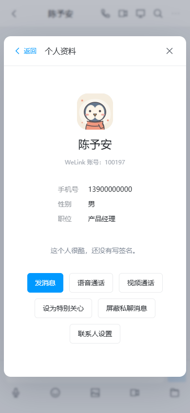
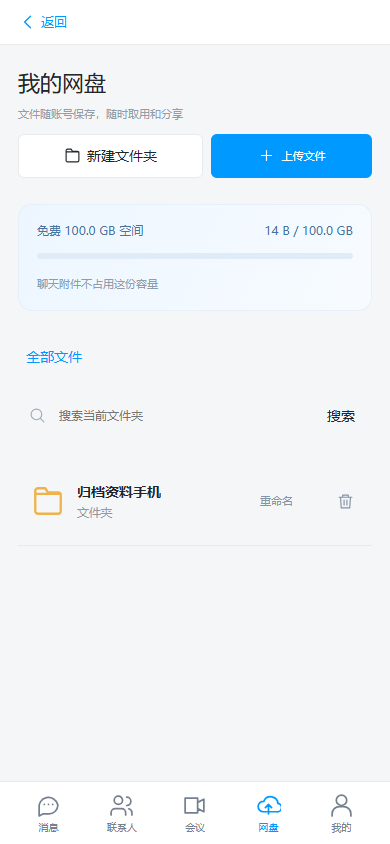
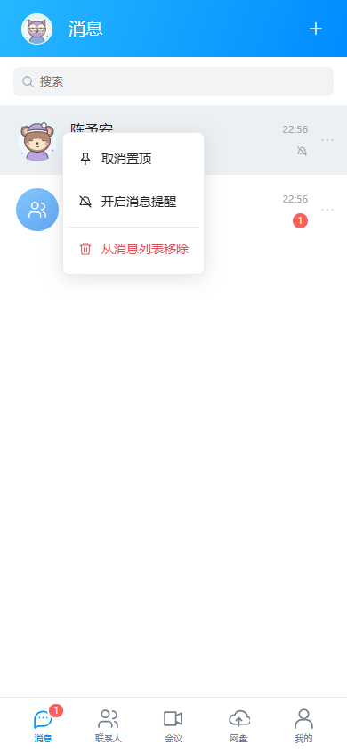
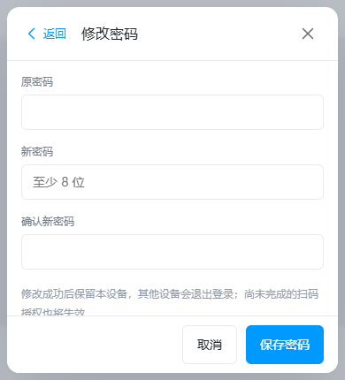

# 0.1.8-preview · 操作流程、网盘文件夹与数字账号

按本次使用反馈，Windows 和 Android 客户端移除“空间 / 写文档”模块：导航、“我的”和联系人资料中的入口，以及 Markdown 编辑、草稿和可见范围的客户端代码一并删除。网盘补上多层文件夹与文件移动，继续提供上传、下载、重命名、删除和分享；已有服务器文档数据未作破坏性清理，旧服务接口保留兼容。

## 操作流程

- 设置子页统一提供“返回”，保存上一级控件、未保存选项、滚动位置与操作处理函数。支持设置 → 账号与安全 → 修改密码 / 登录设备、联系人设置 → 黑名单 / 分组，以及聊天与群设置的返回路径。
- 标题栏和底部操作固定在可见范围，内容区域单独滚动。小屏或键盘压缩后的视口仍能点到返回、取消和保存。移动端打开一般设置表单不再自动唤起键盘；需要输入时主动点击输入框。
- 网盘、管理员等页面增加返回入口；从设置进入账号管理后，可返回设置。Android 系统返回键和界面返回使用同一个处理顺序：菜单、当前弹层、聊天或子页，最后才交给系统退到后台。Windows Esc 同样按当前层返回。
- “返回 / 取消”返回上一层；“完成 / 关闭”结束弹层。头像编辑保留自身的取消和资源释放流程；实时媒体与截图不恢复已失效的采集视图。
- 消息列表每行提供“更多”按钮；Windows 右键、Android 长按也能打开菜单。支持置顶 / 取消、免打扰 / 恢复提醒、标为已读及“从消息列表移除”。单聊和群聊设置中也提供移除入口。
- 移除会话调用已有的个人隐藏接口，在本账号设备间同步，不删除消息、草稿或群成员资格。重启后仍隐藏；新消息到达或再次发起聊天时恢复原有会话和历史。
- 修复长按松手时的合成点击误关菜单：只拦截该次触摸补发的点击，下一次触摸可正常选择菜单。消息、联系人和会话列表共用此处理；滚动取消长按，繁忙时按实际按住时长兜底。
- 提示不再多条叠压，也不拦截底下按钮。桌面拖动仅作用于窗口标题区域，不干扰弹窗。二维码登录页遵守关闭注册的配置。登录、二维码和设置显示 0.1.8 版本号。

## 网盘与入口整理

- 网盘支持新建、进入、重命名和删除文件夹，文件可以移动到根目录或子目录；面包屑和系统返回逐层退出。删除文件夹会明确确认子文件夹、文件与分享链接一并删除。
- 文件夹按账号隔离，所有目录合用该账号 100 GiB 配额。移动只修改目录归属，不复制文件，不改变分享链接。旧客户端未指定目录时仍能列出所有文件。
- 分享永久有效，重复获取沿用同一链接；用户主动取消、删除文件 / 文件夹或管理员删除账号后失效。启动迁移将尚未到期的旧链接转为永久；已经过期或撤销的链接不会复活。
- 新增配置 drive.max_folders（默认 2000）、drive.max_folder_depth（默认 32），旧配置自动采用默认值。生产存储和权限配置保持原样。
- 移除左栏、“我的”以及聊天输入栏重复的远程入口；只保留单聊顶部一处，群聊隐藏。返回或关闭待处理远程邀请会取消 / 拒绝，释放等待状态。
- 表情面板有关闭按钮，点击外部 / 输入框、Esc、Android 返回可收起；连续点表情保留面板与草稿，修复爱心等组合表情被拆开的空按钮。
- 登录只接受当前 6 位数字账号，停用旧别名、昵称和旧 9 位号码。账号管理与注册移除别名输入和展示，返回 API 的 account 与 number 都是当前号码；现有 UUID、密码、号码和会话保持不变。昵称可重名、仍可搜索。

## 资料、文件与声音

- 联系人中显示自己的账号和在线状态；聊天头像和聊天成员头像可打开资料卡。新增手机号、性别、职位，支持自行填写和清空，未填写显示“未设置”。资料保存后向在线设备同步，旧客户端保存姓名不会清空新增字段；黑名单和已注销账号继续限制资料读取。
- 从资料卡发消息后自动收起资料卡；修改资料再进入头像选择时，未提交的手机号、性别和职位会保留。
- “聊天文件”同时提供下载和删除。确认后删除对应的个人消息，在自己的设备同步隐藏；对方记录、独立收藏和已下载的本地副本保留。列表不再包含未发送的上传、已撤回或本人已删除的消息附件。
- 去掉消息列表和空白页下方的“查找用户”，以及输入栏重复的“聊天记录”按钮。保留顶部搜索；Android 顶部原被旧样式隐藏的搜索和单聊远程按钮现在正常显示。
- 设置新增“消息提示音”，即时保存到本设备。Windows 同步保存至 desktop.json，托盘通知使用静音标记；手机保存到 WebView 的持久设置。开关不影响消息通知、未读标记、会话免打扰规则或通话铃声。浏览器移动视口测试验证实际 Web Audio 节点触发；没有据此声称完成安卓锁屏后台推送或扬声器实机听测。

## 验证范围

验证使用本机独立服务和测试账号，不在生产创建账号、聊天或文件。最终回归包含以下检查：

- Go 服务端完整测试与 vet、目录 / 分享 / 登录 / 资料 / 文件删除竞态检查；Windows 配置默认值迁移与独立声音设置持久化。
- `scripts/drive-details-test.mjs` 覆盖嵌套目录、文件移动、永久链接、递归删除、聊天文件删除、表情关闭、唯一搜索 / 远程入口，以及关闭待处理远程邀请。
- `scripts/profile-sounds-test.mjs` 覆盖自己在线、资料编辑 / 读取 / 头像草稿、关闭资料进入聊天、提示音开关持久化与实际 Web Audio 触发。
- `scripts/usability-test.mjs` 覆盖 Windows / 移动视口返回路径、未保存选项保留、会话菜单、双设备移除同步、重启保持隐藏、再次来信恢复历史和草稿、群成员资格、真实触摸事件长按、管理员返回设置，以及 390 × 430 视口中底部按钮的命中测试。
- 消息操作回归覆盖长按、删除同步与对方历史保留、收藏、引用、撤回脱敏、历史搜索 / 分页、设备撤销和修改密码。
- 存储与账号回归覆盖私聊 / 用户搜索、备注与屏蔽、多个拖入文件、65 MiB 聊天附件、网盘 CRUD / 分享 / 隔离、管理员创建 / 重置 / 删除账号及用户改密。旧文档 UI 用例改为确认模块移除，保留后端历史兼容测试。
- 联系人旧测试按已经确定的“全员可搜索、无需好友申请”行为更新，移除早期好友申请 / 隐身搜索开关的断言；继续检查分组、备注、长按和黑名单。

浏览器移动视口和触摸测试不等于 Android 真机验收。本机现有 Android 8 模拟环境未提供可用 WebView，启动检查无法覆盖原生页面；未据此声称完成原生系统返回、软键盘或各型号手机触摸验收。

## 发布

本次更新 Windows 客户端、安装器、Android APK 与服务端 `welink-server-release-20260911-06`。Android 版本码为 9，沿用原签名证书。服务端先备份数据库，再增加目录表和迁移有效分享；已有账号、消息和附件保留。已通过 Windows 原生 WebView2 启动、聊天、托盘、重复进程唤回与待发送队列重启测试；Android lint、APK v2 签名、16 KiB 对齐、121 项资源、4 种 ABI、100 个头像与麦克风生命周期检查。线上安装包在发布后核对 SHA-256、下载大小与分段内容。

更新前客户端保留于 data/releases/before-usability-0.1.8；数据库备份为 data/welink-before-usability-20260911-05.db 与 data/welink-before-profile-details-20260911-06.db。生产数据目录、管理员身份、关闭注册和当前扩容卷配置均保持原样。
